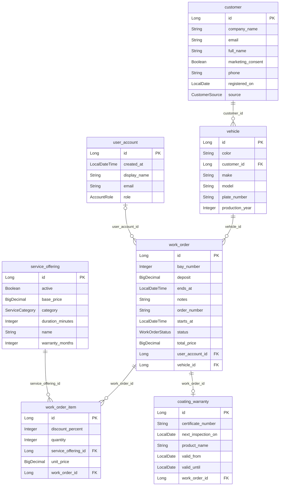

# Schemat bazy danych

Plik generują reguły projektu (panel Maven → Lifecycle → verify). Nie edytujcie go ręcznie.

Tabele: 7 · kolumny: 51 · relacje: 5 × @ManyToOne, 2 × @OneToMany, 1 × @OneToOne, 0 × @ManyToMany

| Tabela | Encja | Kolumny | Klucze obce |
|---|---|---|---|
| coating_warranty | CoatingWarranty | 7 | work_order_id |
| customer | Customer | 8 | — |
| service_offering | ServiceOffering | 7 | — |
| user_account | UserAccount | 5 | — |
| vehicle | Vehicle | 7 | customer_id |
| work_order | WorkOrder | 11 | user_account_id, vehicle_id |
| work_order_item | WorkOrderItem | 6 | service_offering_id, work_order_id |

